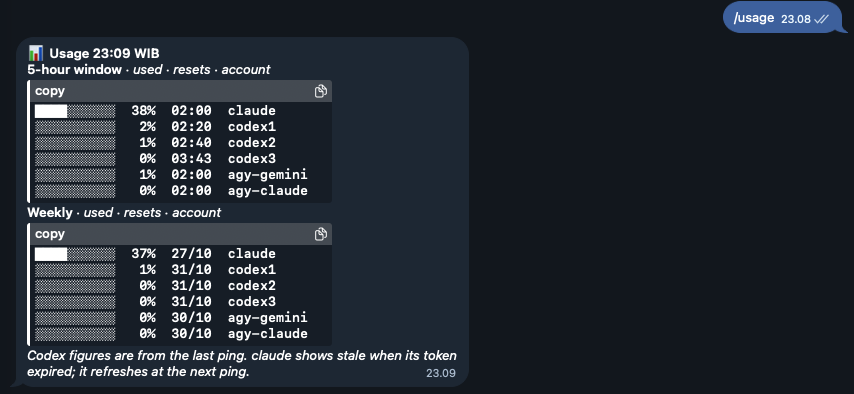

# ai-five-hour-scheduler

Starts the 5-hour usage windows of Claude Code, several Codex accounts and both Antigravity model groups at fixed times (06, 11, 16, 21 WIB), reports usage to Telegram, and answers `/usage` on demand.



```
pinger.timer ──> ping.sh ──> claude / codex (per CODEX_HOME) / agy (per model group)
                    ├──> Healthchecks.io   (dead man's switch)
                    └──> usage.py ──> Telegram report
pinger-bot.service ──> bot.py ──> /usage ──> usage.py ──> Telegram reply
```

All traffic is outbound HTTPS. SSH is reachable only through Tailscale; ufw denies every other inbound connection.

## Layout

| Path | Purpose |
| --- | --- |
| `ping.sh` | Pings every target with timeout and retry, reports to Healthchecks and Telegram, exits 1 if anything failed |
| `usage.py` | Reads quota: Codex rollout files, `agy -p /usage`, Claude OAuth usage endpoint. `--html` renders the Telegram tables |
| `bot.py` | Long-polling Telegram listener for `/usage`. Only answers `TG_CHAT_ID` |
| `systemd/` | Unit templates. `install.sh` fills in `@USER@` and `@HOME@` |
| `install.sh` | Idempotent bootstrap for a fresh Ubuntu 24.04 host |
| `env.example` | Variables expected in `~/.config/pinger/env` |

Secrets never live in the repo. They stay in `~/.config/pinger/env` (mode 600) and in each CLI's own credential store.

Clone the repo to `~/pinger` on the host, whatever the repo is called: the scripts, the units and `install.sh` use that path.

## Fresh host

Requirements: Ubuntu 24.04, about 1 GB RAM (install.sh adds 2 GB swap), a user with sudo.

1. Give the host read access to this private repo with a deploy key:

   ```bash
   ssh-keygen -t ed25519 -f ~/.ssh/pinger_deploy -N "" -C "pinger@$(hostname)"
   cat ~/.ssh/pinger_deploy.pub    # GitHub: repo → Settings → Deploy keys → Add (read-only)
   cat >> ~/.ssh/config <<'EOF'
   Host github.com
     IdentityFile ~/.ssh/pinger_deploy
     IdentitiesOnly yes
   EOF
   git clone git@github.com:Papazy/ai-five-hour-scheduler.git ~/pinger
   ```

2. Run the installer, then follow the steps it prints:

   ```bash
   cd ~/pinger && ./install.sh
   ```

   - `sudo tailscale up --ssh`, disable key expiry for the machine, then re-run `./install.sh` so ufw is enabled.
   - Fill `~/.config/pinger/env` (or copy it from the old host, see below), then re-run `./install.sh` to start the bot.
   - Log in once per CLI from `~/pinger/work`: `claude` → `/login`; `CODEX_HOME=~/.codexN codex login --device-auth` for every account (open each link in a private window); `~/.local/bin/agy`.

3. Test:

   ```bash
   sudo systemctl start pinger.service
   journalctl -u pinger.service -n 30 --no-pager   # every target "ok", report arrives on Telegram
   ```

   Then send `/usage` to the bot.

## Moving to a new host

Do this while the old host is still running.

1. Prepare the new host with the steps above, up to and including the CLI logins.
2. Copy the env file through your Mac (both hosts on the tailnet):

   ```bash
   scp -3 pinger:.config/pinger/env NEWHOST:.config/pinger/env
   ssh NEWHOST 'chmod 600 ~/.config/pinger/env'
   ```

3. Cut over. A bot token allows only one `getUpdates` poller, so stop the old bot first:

   ```bash
   ssh pinger   'sudo systemctl disable --now pinger-bot pinger.timer'
   ssh NEWHOST  'cd ~/pinger && ./install.sh && sudo systemctl start pinger.service'
   ```

4. Check the Telegram report and `/usage`, then delete the old VM. The Healthchecks URL stays the same.

## Adopting this repo on an existing host

```bash
sudo systemctl stop pinger.timer pinger-bot
mv ~/pinger ~/pinger.old
git clone git@github.com:Papazy/ai-five-hour-scheduler.git ~/pinger
cd ~/pinger && ./install.sh
rm -rf ~/pinger.old    # once the test run is green
```

## Updating

```bash
cd ~/pinger && git pull && ./install.sh
```

`install.sh` re-renders the units, reloads systemd and restarts the bot. The timer picks up the new `ping.sh` on its next run.

## Configuration

Defaults live in `ping.sh`; override them in `~/.config/pinger/env`, keeping the quotes:

```bash
CODEX_ACCOUNTS="codex1 codex2 codex3"
AGY_MODELS="agy-gemini:gemini-3.8-flash-low agy-claude:gpt-oss-120b-medium"
```

Adding a Codex account means logging in with `CODEX_HOME=~/.codexN` and adding `codexN` to `CODEX_ACCOUNTS`. Each extra target adds up to 630 s to the worst-case run time, so raise `TimeoutStartSec` in `systemd/pinger.service` if you add many.

## Operations

| Task | Command |
| --- | --- |
| Next run | `systemctl list-timers pinger.timer` |
| Last run | `journalctl -u pinger.service -n 50 --no-pager` |
| Bot log | `journalctl -u pinger-bot -f` |
| Run now | `sudo systemctl start pinger.service` (starts the 5-hour windows now) |
| Update CLIs | `sudo npm install -g @anthropic-ai/claude-code@latest @openai/codex@latest` and re-run the agy installer |
| Claude token expiry | `python3 -c 'import json,os,datetime;e=json.load(open(os.path.expanduser("~/.claude/.credentials.json")))["claudeAiOauth"]["expiresAt"];print(datetime.datetime.fromtimestamp(e/1000))'` |

## Known limits

- Claude usage comes from an undocumented endpoint and needs the full `/login` credentials, not a `setup-token`.
- Between pings, `/usage` shows Codex figures from the last ping, and Claude as `stale` once its access token has expired. Refreshing either would mean running the CLI, which starts a 5-hour window at the wrong time.
- Telegram on some Android clients does not render code blocks in a monospace font, so the report keeps the bar column first and has no header row.

## License

[MIT](LICENSE). Not affiliated with Anthropic, OpenAI or Google.
